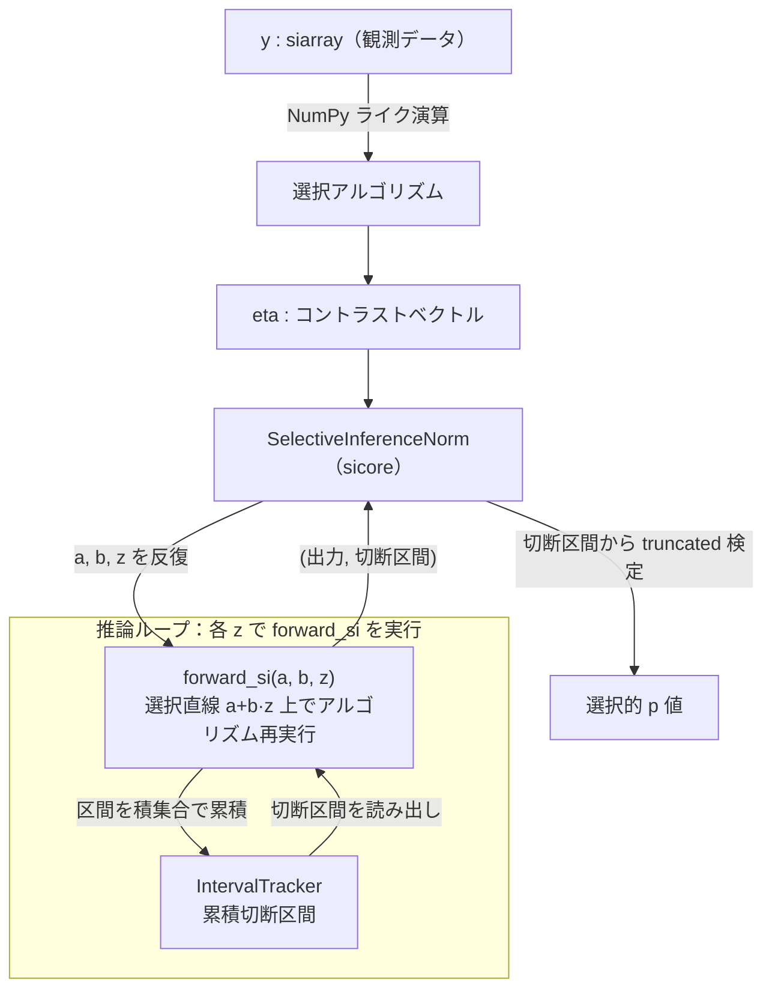

# autosi 仕様書

## 1. 概要と適用範囲

`autosi` は、NumPy ライクに記述した特徴選択アルゴリズムの計算過程から、
**選択イベント**（選択結果が不変となるパラメータ `z` の範囲）を多項不等式の区間として
自動収集するライブラリである。

- 検定統計量は選択直線 `data(z) = a + b·z` 上のパラメータ `z` で表す。
- アルゴリズム中の比較・選択演算は、選択結果が変わらない `z` の範囲を区間として算出し、
  積集合で累積する。
- 選択的 p 値の算出は [sicore](https://github.com/takeuchi-lab/sicore) の
  `SelectiveInferenceNorm` に委譲する。`autosi` は **選択イベントを区間へ変換する層**を担う。

適用範囲は正規分布を仮定する parametric Selective Inference とする。p 値計算本体・
分布の仮定は sicore の仕様に従う。

---

## 2. 用語定義

| 用語 | 定義 |
|------|------|
| 有理関数 | `z` の多項式どうしの商 `num(z) / den(z)` |
| 選択直線 | データ点を 1 パラメータ `z` で表した直線 `a + b·z` |
| 切断区間 | アルゴリズムが観測時と同一の選択を行う `z` の集合（`sicore.RealSubset`） |
| 選択イベント | 比較・選択演算 1 回が課す「選択結果が不変」という条件 |
| iso-sign interval | ある多項式が、指定点 `z` の周りで符号を変えない最大区間 |
| 区間計算ポイント | アルゴリズム実行中に区間計算を発生させる個々の演算箇所 |

---

## 3. アーキテクチャ

### 3.1 処理フロー



切断区間は `IntervalTracker` に累積され、`forward_si` がそれを読み出して sicore へ
返す。sicore はこの切断区間を用いて p 値を算出するため、`IntervalTracker` は
p 値計算の経路上にある。

### 3.2 モジュール構成と責務

#### ライブラリ本体 `autosi/`

| ファイル | 責務 |
|----------|------|
| [`__init__.py`](autosi/__init__.py) | 公開 API の集約 |
| [`siarray.py`](autosi/siarray.py) | 中核データ構造。`z` の有理関数として配列を表現する。5 つの Mixin を合成する |
| [`_mixin_arithmetic.py`](autosi/_mixin_arithmetic.py) | 算術演算子 `+ - * / @ ** -` と `abs`、通分 |
| [`_mixin_comparison.py`](autosi/_mixin_comparison.py) | 比較演算子 `< <= > >= == !=`（比較を選択イベントとして区間追跡する） |
| [`_mixin_index.py`](autosi/_mixin_index.py) | 添字アクセス・要素代入・スカラー変換（`int` / `bool` / `index`） |
| [`_mixin_array.py`](autosi/_mixin_array.py) | 配列操作 `T` / `transpose` / `inv` / `reshape` / `argsort` / `copy` |
| [`_mixin_reduction.py`](autosi/_mixin_reduction.py) | 集約演算 `sum` / `mean` |
| [`functions.py`](autosi/functions.py) | 関数版 API（`max` / `min` / `argmax` / `argsort` / `sum` / `mean` / `abs` / `stack` / `array`） |
| [`constraints.py`](autosi/constraints.py) | 選択イベントを `IntervalTracker` に積み上げる共通ヘルパ |
| [`interval_tracker.py`](autosi/interval_tracker.py) | 累積切断区間と現在の `z` を保持するシングルトン |
| [`poly_utils.py`](autosi/poly_utils.py) | 多項式演算と、多項不等式から区間を求める計算本体 |
| [`poly_memo.py`](autosi/poly_memo.py) | 区間計算のメモ化 |
| [`inf.py`](autosi/inf.py) | `inference()` と `InferenceProblem`（推論セッションの状態と sicore 向けコールバック） |
| [`utils.py`](autosi/utils.py) | 後方互換用の再エクスポートシム |

#### 実験スクリプト `src/`

ライブラリを用いた評価実験一式。運用手順は [README.md](README.md) に従う。

| ファイル | 責務 |
|----------|------|
| [`methods.py`](src/methods.py) | 3 手法（marginal screening / lasso / cv_r2_lasso）の SI アルゴリズム |
| [`data.py`](src/synthetic/data.py) | 実験データ生成（iid / corr、null / signal） |
| [`run_experiment.py`](src/run_experiment.py) | 1 ジョブ分の計算本体（p 値・計算時間を CSV 出力） |
| [`environment.py`](src/environment.py) | BLAS スレッド数固定・乱数シード設定 |
| [`plot_results.py`](src/plot_results.py) / [`plot_power.py`](src/plot_power.py) | 結果のグラフ生成 |
| [`merge_results.py`](src/merge_results.py) | 分割 CSV の統合・読み込み |
| `synthetic_fpr.sh` / `synthetic_power.sh` | PBS (qsub) 向けジョブ投入ランチャ |

---

## 4. データ構造仕様: `siarray`

### 4.1 表現

`siarray` は配列の各要素を `z` の有理関数として保持する。

$$\text{value}(z) = \frac{\sum_{i} \texttt{coef\_num}[i]\,z^{i}}{\sum_{i} \texttt{coef\_den}[i]\,z^{i}}$$

### 4.2 属性

| 属性 | 型 | 定義 |
|------|----|------|
| `coef_num` | `list[np.ndarray]` | 分子係数。`coef_num[i]` は `z^i` の係数で、配列形状は `_shape` に一致する |
| `coef_den` | `list[np.ndarray]` | 分母係数。同上 |
| `_shape` | `tuple[int, ...]` | 論理形状。公開プロパティ `shape` で参照する |

### 4.3 規約

- 定数（観測データ等）は次数 0（`coef_num=[X]`, `coef_den=[1]`）として表現する。
- `data` プロパティは現在の `z`（`IntervalTracker` が保持）を代入した値 `np.ndarray` を返す。
  `z` が `None` のときは `z = 0.0` を用いる。
- `shape` / `ndim` / `size` / `dtype` は NumPy 配列と同じ意味を持つ。
- 比較・選択演算は `data` の値で分岐を決定し、その分岐が不変となる区間を制約とする。

---

## 5. 状態管理仕様: `IntervalTracker`

`IntervalTracker`（[`interval_tracker.py`](autosi/interval_tracker.py)）は本ライブラリの
中核状態であり、**利用者のアルゴリズムと推論ループの間で切断区間を受け渡す唯一の媒介**で
ある。比較・選択演算はここから現在の `z` を読み、算出した区間をここへ積集合で書き戻す。

### 5.1 役割と設計根拠

- 1 回の `forward_si` 実行で生じた全選択イベントの区間を、1 つの累積区間に集約する。
- アルゴリズムは利用者が自由に記述する純粋な `siarray` 演算であり、各演算へ区間蓄積先を
  引数で引き回すのは非現実的である。よってプロセス内で **単一インスタンスを共有**し、
  演算側は蓄積先の存在を意識せず制約を登録できるようにする（グローバル状態とする根拠）。

### 5.2 保持する状態

| 属性 | 型 | 定義 |
|------|----|------|
| `_intervals` | `RealSubset \| None` | 累積切断区間。初期値・リセット直後は全実数 `[[-∞, +∞]]` |
| `_z` | `float \| None` | 現在評価中の `z`。比較・選択演算がどの分岐を取るかの判定と区間計算に用いる |

- `_z = None` は「`inference` 前にアルゴリズムを直接実行している状態」を表し、このとき
  `siarray.data` は `z = 0` で評価し、区間追跡とメモ化を行わない。

### 5.3 インタフェース

| メソッド | 規定 |
|----------|------|
| `get_instance()` | クラスメソッド。単一インスタンスを生成・取得する |
| `reset(z=None)` | `_intervals` を全実数へ初期化し、`_z` を設定する |
| `set_z(z)` | `_z` を設定する |
| `get_z()` | `_z` を返す |
| `update(new)` | `_intervals` を `new` との **積集合**で更新し、更新後の値を返す。`_intervals` が `None` のときは `new` で初期化する |
| `get()` | `_intervals` を返す（`None` のときは `reset()` してから返す） |
| `get_state()` | `{"intervals": _intervals, "z": _z}` を返す（デバッグ用） |

区間の書き込みは `update` のみが行い、合成は必ず積集合とする。`siarray` の各演算は
`update` を直接は呼ばず、[`constraints.py`](autosi/constraints.py) のヘルパ（6.3 参照）を介して更新する。

### 5.4 ライフサイクル（`forward_si` 1 回あたり）

`forward_si(a, b, z)` は次の順で `IntervalTracker` を駆動する。

1. `reset()` で累積区間を全実数へ戻す（前回の `z` の制約を持ち越さない）。
2. `set_z(z)` で現在の `z` を設定する。
3. アルゴリズム実行中、各比較・選択演算が `get_z()` で `z` を読み、`update()` で区間を積む。
4. `get()` で最終累積区間を読み出し、出力とともに sicore へ返す。

毎回 1 で初期化するため、`z` の異なる `forward_si` 呼び出し間で状態は混ざらない。

### 5.5 並行性とスコープの制約

- `_instance` はクラス属性（シングルトン本体）、状態 `_intervals` / `_z` はインスタンス
  属性である。状態はプロセス内で共有される。
- 本クラスは**スレッドセーフではない**。グローバル共有状態のため、**同一プロセス内で
  複数の `inference` を並行実行してはならない**。
- 実験 (`src/`) は `ProcessPoolExecutor` によるプロセス分離で並列化し、各プロセスが独立した
  `IntervalTracker` を持つことでこの制約を満たす。

---

## 6. 演算仕様

### 6.1 区間追跡の有無

各演算が選択イベントを追跡するか否かを次に定める。追跡する演算のみが
`IntervalTracker` を更新する。

| 演算 | 区間追跡 | 課す制約 |
|------|:--------:|----------|
| `+ - * / @ ** -` | なし | 係数のみ更新する |
| `sum` / `mean` / `prod` / `var` | なし | 係数のみ更新する（有理保存） |
| `stack` / `concatenate` / `flatten` / `reshape` / `transpose` | なし | 形状操作のみ |
| `abs` | あり | 各要素の符号（`num > 0` または `-num > 0`）を保つ |
| `< <= > >=` | あり | 差 `self - other` の符号を保つ |
| `== !=` | なし | 選択に影響しないため追跡しない |
| `max` / `min` | あり | 選択要素が全要素以上（`min` は以下）である順序を保つ |
| `argmax` / `argmin` | あり | `max` / `min` と同じ順序制約。返り値はインデックス |
| `argsort` / `sort` | あり | ソート後の隣接要素の大小を保つ |

### 6.2 比較演算の意味論

- `a > b` は `(a − b) / den > 0`、`a < b` は `−(a − b) / den > 0` を制約として課す。
- スカラーは単一区間として、配列は全要素をバッチで追跡する。
- 返り値は、サイズ 1 なら Python `bool`、それ以外は `np.ndarray` とする。

### 6.3 制約追加インタフェース

選択イベントの区間追跡は [`constraints.py`](autosi/constraints.py) に集約する。各演算は
次の関数を通じて `IntervalTracker` を更新する。現在の `z` は内部で参照する。

| 関数 | 入力 | 意味 |
|------|------|------|
| `add_constraint(num, den)` | 単一の係数ベクトル | `num / den > 0` の区間を積集合で追加する |
| `add_batch_constraints(nums, dens)` | 係数行列 `(n, deg)` | `n` 個の `num_i / den_i > 0` を一括追加する |
| `add_order_constraints(diffs)` | 差分 `siarray` のリスト | 各 `diff > 0` を一括追加する |

---

## 7. 区間計算アルゴリズム仕様

実装は [`poly_utils.py`](autosi/poly_utils.py)。「有理関数が符号を保つ `z` の範囲」を求めることを核心とする。

### 7.1 多項式演算

- `poly_add` / `poly_sub` / `poly_mul`: 多項式の加減乗。`poly_mul` はスカラー係数では
  `np.convolve`、配列係数ではスライス加算でベクトル化する。
- `poly_reduce`: 分子・分母を GCD（ユークリッド互除法 `_poly_gcd_1d`）で約分し、次数膨張を抑える。

### 7.2 根の算出（`z` 非依存）

多項式の次数に応じて根を求める。根は `z` に依存しない。

| 次数 | 算出方法 |
|------|----------|
| 0（定数） | 根なし。区間は全実数とする |
| 1（線形） | 解析解 `-a / b` |
| 2 以上 | コンパニオン行列の固有値（`np.linalg.eigvals` をバッチ実行）。実部を用いる |

### 7.3 iso-sign interval の決定

点 `z` における多項式の iso-sign interval を次で定める。

1. `z` 未満の最大根を下限とする（存在しなければ `−∞`）。
2. `z` 超過の最小根を上限とする（存在しなければ `+∞`）。

### 7.4 有理関数の符号区間

`num / den > threshold` となる区間を次の和集合で定める。

- `den > 0` かつ `num − den·threshold > 0`
- `den < 0` かつ `num − den·threshold < 0`

それぞれの条件は 7.3 の iso-sign interval の積集合として求める。

### 7.5 累積

各区間計算ポイントで得た区間を、`IntervalTracker` の保持する累積区間に **積集合**で合成する
（5.3 の `update`）。`forward_si` の開始時に累積区間を全実数へリセットする。

---

## 8. 推論 API 仕様

### 8.1 `inference`

```python
inference(eta, prob_vec, var, algorithm, model=None, memoize=True, **kwargs)
```

| 引数 | 型 | 規定 |
|------|----|------|
| `eta` | `siarray` | コントラストベクトル |
| `prob_vec` | `siarray` | 確率変数ベクトル（= `y`） |
| `var` | `float \| np.ndarray` | `prob_vec` の分散または共分散行列 |
| `algorithm` | `Callable[[siarray], siarray]` | `y` を受け取り `eta` を返す選択アルゴリズム |
| `model` | `siarray \| None` | 観測モデル。`None` のとき `eta` を観測モデルとみなす |
| `memoize` | `bool` | メモ化の有効化（既定 `True`） |
| `**kwargs` | — | sicore `inference` へ委譲する |

**事前条件**: `algorithm` は `siarray` 演算のみで構成する。
**動作**:

1. メモ化を `memoize` に設定し、キャッシュをリセットする。
2. `prob_vec` / 観測モデル / `algorithm` から `InferenceProblem` を生成する。
3. `SelectiveInferenceNorm(prob_vec, var, eta_vec)` を構築する。
4. `forward_si` と `model_selector` を渡して sicore の `inference` を実行する。

**返り値**: sicore の推論結果オブジェクト（`p_value` 等を持つ）。
**例外**: 仮説が得られず統計量が `NaN` の場合 `NoHypothesisError` を送出する。

### 8.2 `InferenceProblem`

推論セッションの状態と sicore 向けコールバックを保持する。

| メンバ | 規定 |
|--------|------|
| `prob_vec` / `observed_model` / `algorithm` | セッション状態 |
| `forward_si(a, b, z)` | 選択直線上の点 `a + b·z` でアルゴリズムを再実行し、`(出力, 切断区間)` を返す |
| `model_selector(model)` | 観測モデルと探索中モデルの一致を `np.allclose` で判定する |

`forward_si` の手続き:

1. `IntervalTracker` をリセットし `z` を設定する（5.4 参照）。
2. `a + b·z` を 1 次の有理関数として構築し、`algorithm` を実行する。
3. 累積区間と出力を取得して返す。区間計算は区間計算ポイントごとにメモ化される（9 章参照）。

---

## 9. メモ化仕様

1 回の `inference()` 内では選択直線 `a, b` が固定で `z` のみが変化する。したがって
各区間計算ポイントの多項式係数は `forward_si` 呼び出し間で不変であり、根は `z` に依存しない。
この性質を用いて、**個々の区間計算ポイントの区間計算**をメモ化する。実装は
[`poly_memo.py`](autosi/poly_memo.py)。キーは多項式係数のハッシュとする。

| レベル | 対象 | 規定 |
|--------|------|------|
| A（根キャッシュ） | `z` 非依存の根 | 係数ハッシュをキーに固有値結果をキャッシュし、再計算を省く |
| B（区間キャッシュ） | 区間計算ポイント × `sign(z)` | 結果が一定となる区間 `[lo, hi]` と結果を保持。新しい `z` が `[lo, hi]` に入れば計算をスキップする |

**保証・管理**:

- キーは係数ハッシュであり、p 値が変われば `a, b` が変わり係数も変わる。よって別キーとなり、
  誤った再利用は発生しない。
- `inference()` 開始時に必ずキャッシュをリセットする。各区間計算ポイントにつき符号別に最新 1 件のみ保持する。
- `z` が `None` のときはメモ化を迂回する。

**制御**:

- 呼び出し単位: `inference(..., memoize=False)`（既定 `True`）。
- グローバル: `set_memoization(False)` / `reset_memoization()`。

---

## 10. 保証する不変条件

- 累積区間は積集合演算でのみ更新する。したがって演算順序に依存せず、最終区間は
  「全選択イベントを同時に満たす `z` の集合」に一致する。
- メモ化の有無は数値結果を変えない。区間キャッシュは結果が一定となる範囲でのみ再利用する。
- 算術演算は係数を更新するのみで区間を変化させない。

---

## 11. 公開 API

[`autosi/__init__.py`](autosi/__init__.py) が公開する識別子を次に定める。

| 名前 | 種別 | 規定 |
|------|------|------|
| `siarray` | クラス | 有理関数配列（中核データ構造） |
| `array` | 関数 | `siarray` を構築する |
| `inference` | 関数 | 選択的 p 値を計算する |
| `NoHypothesisError` | 例外 | 仮説が得られなかった場合に `inference` が送出する |
| `max` / `min` / `argmax` / `argmin` / `argsort` / `sort` | 関数 | 区間追跡つきの選択演算 |
| `sum` / `mean` / `prod` / `var` / `abs` | 関数 | 集約・要素演算 |
| `stack` / `concatenate` / `flatten` | 関数 | 形状操作 |
| `set_memoization` / `reset_memoization` | 関数 | メモ化のグローバル制御 |
| `IntervalTracker` | クラス | 累積区間管理（通常は直接使用しない） |

---

## 付録: 使用例

```python
import numpy as np
import autosi as si

rng = np.random.default_rng(0)
beta = np.zeros(10)
X = rng.normal(0, 1, (200, 10))
y = X @ beta + rng.normal(0, 1, 200)

y = si.siarray(y)
X = si.siarray(X)

def merginal_screening(y):
    corr = X.T @ y 
    eta = (X.T @ X).inv() @ X.T
    idx = si.argsort(si.abs(corr))[-1]
    return eta[idx]

eta = merginal_screening(y)
result = si.inference(
  eta=eta, prob_vec=y, var=1.0, algorithm=merginal_screening
  )
print(result.p_value)
```
